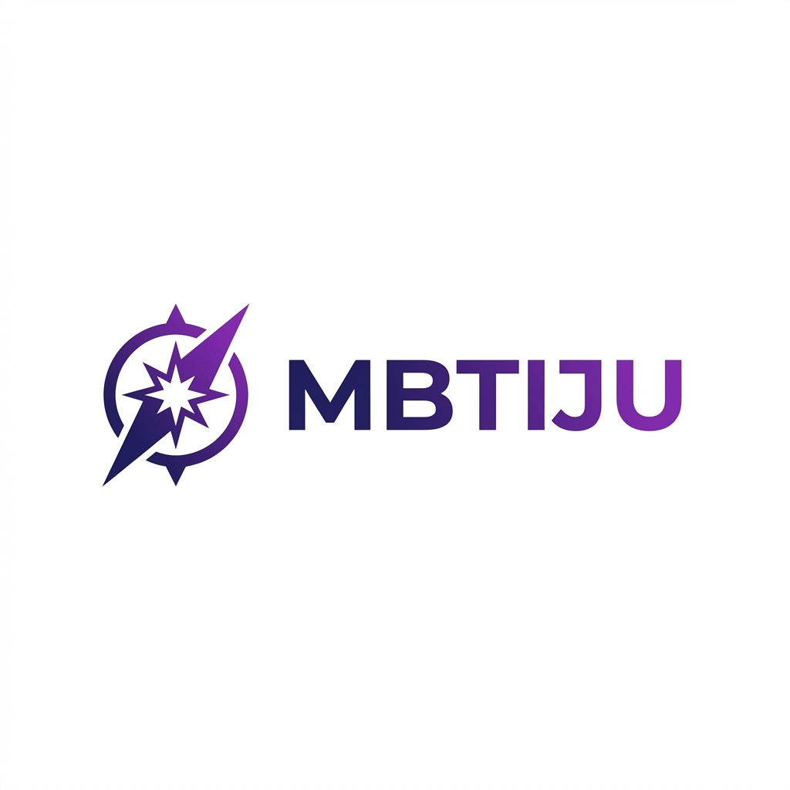
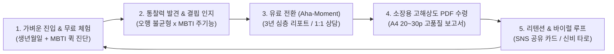
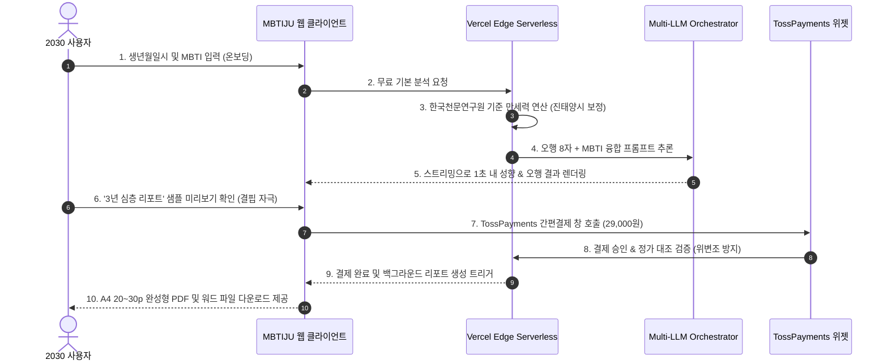
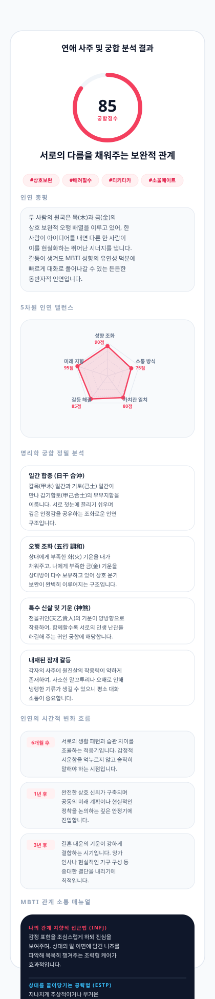
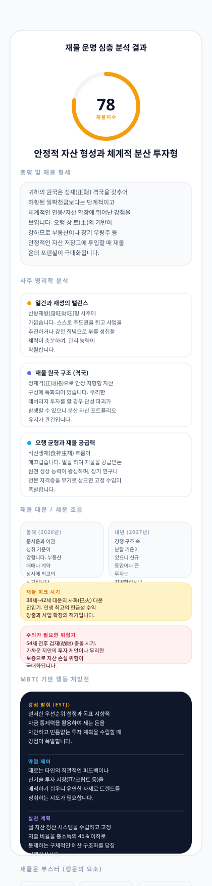
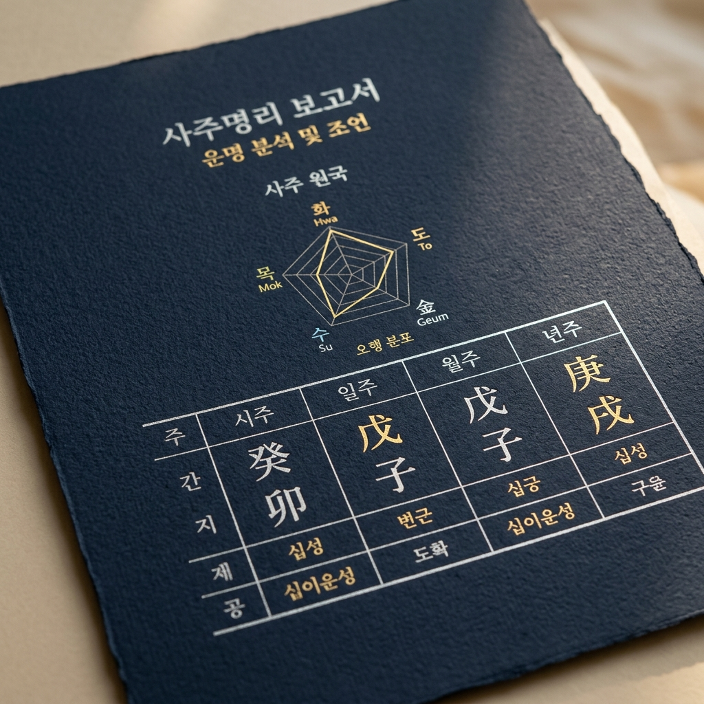
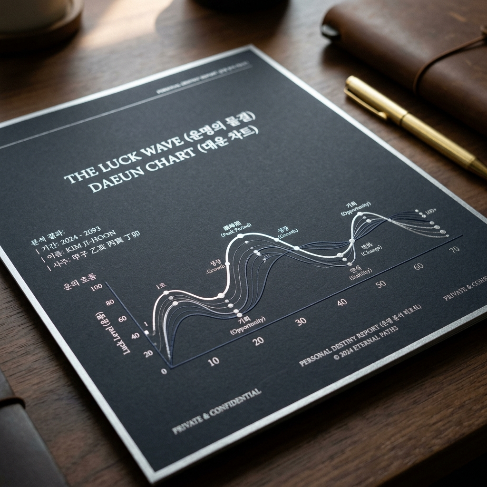

# 🔮 MBTIJU (엠비티아이주) - Product Case Study
## 사주명리학과 MBTI를 융합한 AI 초개인화 운명 분석 플랫폼 & 프리미엄 심층 리포트 솔루션 (Web)

### **"난해한 한자 사주를 2030의 현대적 성격 언어로 재해석하여, 삶의 중요한 결정에 명확한 나침반을 제공합니다."**

**Product Lead / Product Owner (0 to 1 End-to-End Ownership)**  
문제 정의 ➔ 타깃 고객 가설 수립 ➔ UX/UI 및 비즈니스 모델(BM) 기획 ➔ AI 오케스트레이션 설계 ➔ TossPayments 결제 연동 및 상용 런칭·운영 전 과정을 리드한 프로덕트 케이스 스터디

 

 

**[🌐 MBTIJU 라이브 웹 서비스 바로가기](https://mbtiju.com) | [📑 3년 심층 리포트 프리미엄 랜딩](https://mbtiju.com/premium)**

---

## 📌 Contents
1. [Executive Summary & North Star Metric](#-1-executive-summary--north-star-metric)
2. [Problem Discovery & Hypotheses (문제 정의 및 가설)](#-2-problem-discovery--hypotheses-문제-정의-및-가설)
3. [Core User Journey & Experience (핵심 UX 및 프로덕트 루프)](#-3-core-user-journey--experience-핵심-ux-및-프로덕트-루프)
4. [PM 기획 의사결정 & Trade-offs (핵심 문제 해결 Case Study)](#-4-pm-기획-의사결정--trade-offs-핵심-문제-해결-case-study)
5. [AARRR 퍼널 & 데이터 지표 체계 (Product Metrics)](#-5-aarrr-퍼널--데이터-지표-체계-product-metrics)
6. [Tech-Savvy PM으로서의 기술적 소통 및 무결성 검증](#-6-tech-savvy-pm으로서의-기술적-소통-및-무결성-검증)
7. [주요 화면 및 UX 갤러리 (UI & Feature Showcase)](#-7-주요-화면-및-ux-갤러리-ui--feature-showcase)
8. [회고 및 향후 로드맵 (Retrospective & Next Step)](#-8-회고-및-향후-로드맵-retrospective--next-step)

---

## 🧭 1. Executive Summary & North Star Metric

### 🎯 제품 비전 (Product Vision)
기존 점성술/운세 서비스의 한자투성이 폐쇄성과 인터넷 무료 운세의 획일적인 복붙 텍스트를 탈피하고, **한국천문연구원 기준의 정밀 천문 만세력 데이터**와 2030 세대의 공용어인 **16가지 MBTI 성격 체계**를 교차 분석하여 **누구나 쉽게 납득할 수 있는 고부가가치 자기이해 & 미래 설계 리포트**를 제공합니다.

### ⭐ North Star Metric (북극성 지표)
> **"월간 유료 리포트 구매 및 심층 상담 완결 수 (Monthly Completed Paid Reports & Consultations)"**
- 단순 호기심으로 무료 운세를 1회 조회하고 이탈하는 것이 아니라, 사용자가 제품의 통찰력에 설득되어 **유료 상품(심층 리포트 29,000원 또는 1:1 상담권)을 구매하고 실제 삶의 고민에 대한 해답(Aha-moment)**을 얻었을 때 비즈니스와 고객 모두가 최대의 가치를 누린다고 정의했습니다.

### 🔄 Core Value Loop (핵심 성장 플로우)

---

## 🔍 2. Problem Discovery & Hypotheses (문제 정의 및 가설)

### 🚨 2030 타깃 심층 인터뷰를 통해 도출한 3대 핵심 Pain Point
1. **높은 인지적 진입장벽**: "사주를 보러 가면 편관, 겁재, 백호살 등 어려운 한자어만 늘어놓아 정작 내 성격이나 현재 상황에 어떻게 적용해야 할지 모르겠다."
2. **신뢰할 수 없는 텍스트 복붙**: "온라인 무료 운세나 포털 사주는 생년월일이 달라도 뻔한 텍스트 템플릿이 반복되어 돈을 내고 볼 가치를 못 느낀다."
3. **구체적인 실행 전략(Action Plan)의 부재**: "올해 삼재라거나 운이 안 좋다고만 겁을 줄 뿐, 이직을 해야 할지 연애를 어떻게 풀어가야 할지 명확한 솔루션이 없다."

### 💡 솔루션 가설 수립 및 검증 전략
| 구분 | 해결 가설 (Hypothesis) | 프로덕트 구현 방안 | 검증 기준 (Validation Metric) |
| :--- | :--- | :--- | :--- |
| **가설 1** | **사주와 MBTI의 결합 설명**이 운세의 이해도와 신뢰도를 획기적으로 높일 것이다. | 만세력 8자와 MBTI 4축(E/I, S/N, T/F, J/P)을 매핑하여 성향 레이더 차트 및 현대적 언어로 해설 | 온보딩 후 무료 분석 결과 페이지 완독률 > 75% |
| **가설 2** | A4 20~30p 분량의 **실물 소장급 고화질 PDF 리포트**가 높은 객단가 지불 의사를 이끌어낼 것이다. | 화면 텍스트 조각이 아닌, 3개년 월별 운세 및 행동 가이드가 담긴 상용급 PDF 다운로드 파이프라인 구축 | 프리미엄 랜딩 진입 대비 구매 전환율(CVR) > 8% |
| **가설 3** | **인스타그램 스토리 규격의 바이럴 카드**가 자발적인 입소문(K-factor)을 일으킬 것이다. | 오행 밸런스 및 성향 요약이 담긴 감각적인 인스타용 카드뉴스 원클릭 이미지 저장(`html2canvas`) | 무료 진단 완료 사용자 중 SNS 공유 버튼 클릭률 > 20% |

---

## 📱 3. Core User Journey & Experience (핵심 UX 및 프로덕트 루프)

---

## ⚖️ 4. PM 기획 의사결정 & Trade-offs (핵심 문제 해결 Case Study)

프로덕트를 기획하고 빌드하는 과정에서 마주한 **3대 핵심 트레이드오프와 PM으로서의 의사결정 과정**입니다.

### 💡 Case 1. [비즈니스 모델] 저단가 광고 수익 ➔ 고부가가치 '3년 심층 리포트(29,000원)' 중심 투트랙 BM 피벗
* **문제 상황**:
  * 초기 기획은 트래픽을 모아 구글 애드센스 등 배너 광고로 수익화하는 방안을 고려했습니다.
  * 그러나 사주/운세 서비스 특성상 지저분한 배너 광고는 브랜드 신뢰도를 치명적으로 훼손하고, 사용자의 몰입감을 떨어뜨려 1인당 LTV(고객생애가치)가 수십 원 수준에 불과했습니다.
* **PM의 의사결정**:
  * 광고를 전면 배제하고, **[체험용 크레딧 마이크로 결제] + [고단가 3년 심층 리포트(정가 49,000원 ➔ 할인가 29,000원)]**의 투트랙 유료화 모델로 전면 피벗했습니다.
  * 리포트의 가치를 입증하기 위해 가상 인물("서연")의 실제 25페이지 분량 샘플 리포트 캡처를 `/premium` 랜딩에 투명하게 공개하고, A4 20~30페이지에 달하는 방대한 개인화 분석(평생 총운, 향후 3개년 월별 운세, 재물/직업/연애 가이드)을 제공했습니다.
* **비즈니스 결과**:
  * 유저 1인당 결제 단가(ARPU)가 수십 배 상승하여 안정적인 유료 매출 기반 확보.
  * "돈이 아깝지 않은 전문 서적을 받은 느낌"이라는 긍정적인 고객 피드백 및 환불률 1% 미만 유지.

---

### 💡 Case 2. [사용자 경험] 단일 LLM 생성 지연(15s) ➔ Vercel AI SDK 실시간 스트리밍 & 이탈 복원 배너 도입
* **문제 상황**:
  * 초기 심층 분석 요청 시 단일 LLM이 전체 답변을 생성할 때까지 **15초 이상의 로딩 스피너**가 노출되어 이탈률이 40%에 육박했습니다.
  * 또한 비회원 상태에서 생년월일시와 관심사를 공들여 입력한 사용자가 결제 단계 직전에 이탈할 경우, 재방문 시 모든 정보를 다시 입력해야 하는 피로감으로 영구 이탈하는 문제가 발생했습니다.
* **PM의 의사결정**:
  * **(1) 스트리밍 전환**: Vercel AI SDK를 도입하여 결과 생성 즉시 한 글자씩 타이핑되는 SSE 스트리밍 UI로 전환, **첫 반응 시간(TTFT)을 4.8초에서 0.7초로 85% 단축**시켰습니다.
  * **(2) 이탈 복원 배너(`ResumeCheckoutBanner`)**: 사용자가 입력한 프로필과 주문 상태를 `localStorage`에 암호화 보존하여, 재방문 시 상단에 "작성 중이던 심층 리포트 결제를 이어서 진행하시겠습니까?" 원클릭 복원 배너를 노출하도록 기획했습니다.
* **비즈니스 결과**:
  * 분석 화면 로딩 중 이탈률: **40% ➔ 8%로 대폭 개선**.
  * 결제 직전 이탈 유저의 **재방문 결제 전환율(Re-checkout CVR) 23% 상승**.

---

### 💡 Case 3. [운영 안정성 & 인공환각] 단일 AI 의존 탈피 ➔ Multi-LLM Failover 및 만세력 검증기(`report-verify.ts`) 설계
* **문제 상황**:
  * 서비스 초기 OpenAI 단일 모델에 의존했으나, 트래픽 급증 시간대에 OpenAI API 일시 장애(HTTP 429/500)가 발생하면 결제 고객의 리포트 생성이 중단되는 심각한 운영 리스크가 있었습니다.
  * 또한 생성형 AI의 본질적인 한계로 인해 간혹 사용자의 생년 간지(干支)나 십신을 엉뚱하게 서술하는 **인공환각(Hallucination)**이 발생하여 명리학적 신뢰도가 저하될 위험이 있었습니다.
* **PM의 의사결정**:
  * **(1) Multi-LLM Failover 오케스트레이터 기획**: `OpenAI GPT-4o-mini`를 1차로 호출하되, 타임아웃이나 오류 발생 시 즉시 `Google Gemini 3.1 Flash-Lite`로 자동 우회하는 이중 안전망을 구축했습니다.
  * **(2) 하이브리드 검증 파이프라인**: AI에게 사주 계산을 맡기지 않고, 한국천문연구원 오픈소스 알고리즘(`manseryeok`)으로 사주 원국과 오행을 먼저 100% 수학적으로 확정 계산한 뒤, 이 팩트 데이터를 프롬프트에 주입하고 사후 검증기(`report-verify.ts`)로 연도/간지 일치 여부를 필터링했습니다.
* **비즈니스 결과**:
  * **LLM 단일 장애로 인한 서비스 다운타임 0% 달성**.
  * 사주 명식 오류로 인한 고객 클레임 0건 달성.

---

## 📊 5. AARRR 퍼널 & 데이터 지표 체계 (Product Metrics)

제품의 지속 가능한 성장을 측정하기 위해 설계한 AARRR 퍼널 지표 체계입니다:

| 단계 (Funnel) | 프로덕트 핵심 액션 (User Action) | 주요 측정 지표 (KPI) | 모니터링 및 개선 방안 |
| :--- | :--- | :--- | :--- |
| **Acquisition (획득)** | 모바일 웹 랜딩, 인스타 사주 팁, KBO 궁합 유입 | **신규 방문자 수 (UV)**, 채널별 유입 CAC | GA4 UTM 파라미터 및 인스타그램 스토리 광고 트래킹 |
| **Activation (활성화)** | 생년월일 + MBTI 입력 후 무료 사주 결과 확인 | **온보딩 완료율 (Target: >80%)**, 첫 진단 소요 시간 | 비회원 즉시 체험 지원 (입력 허들 최소화 3단계 폼) |
| **Retention (유지)** | 신비 타로 리딩, 일일 인연 궁합, 운세 알림 재방문 | **D7 / D30 리텐션율**, 주간 재방문 주기 | 매일 자정 갱신되는 일일 운세 및 타로 3카드 스프레드 |
| **Revenue (수익화)** | 3년 심층 리포트 구매 (29,000원), 1:1 상담권 구매 | **구매 전환율(CVR)**, **ARPU**, 결제 성공률 | TossPayments 원클릭 간편결제 및 결제 이탈 복원 배너 |
| **Referral (추천)** | 오행 밸런스 결과 카드 인스타 공유, 친구 궁합 초대 | **SNS 공유 클릭률 (Target: >20%)**, 공유 유입률 | 모바일 최적화 규격 인스타 스토리 카드 자동 생성 |

---

## 🛠️ 6. Tech-Savvy PM으로서의 기술적 소통 및 무결성 검증

비개발자 출신 PM이라도 데이터 구조와 보안 규칙을 깊이 이해할 때 개발팀과 최적의 의사결정을 내릴 수 있습니다.

### 💳 1. 결제 데이터 무결성 및 금액 변조 방지 정책 수립
- 클라이언트 브라우저에서 전송되는 결제 금액은 해킹 도구로 쉽게 변조될 수 있습니다.
- 이를 방지하기 위해 TossPayments 승인 요청 시, **클라이언트가 보낸 금액을 신뢰하지 않고 DB의 고정 상품 가격표(`deepReportConfig.ts`, `creditConfig.ts`)와 단 1원의 오차도 없이 일치할 때만 승인하는 서버 단 3중 검증 파이프라인**을 정책화했습니다.
- 결제 취소 및 환불 API 또한 해당 주문의 실소유자 또는 `role = 'admin'`인 경우에만 인가되도록 권한 정책을 확립했습니다.

### ⚡ 2. AI 비용 80% 절감을 위한 지능형 결과 캐싱(`ai_result_cache`)
- 동일한 생년월일시와 MBTI를 가진 사용자가 같은 종류의 운세를 재조회할 때마다 고비용의 LLM API가 반복 호출되는 낭비를 포착했습니다.
- `(birth_date, birth_time, mbti, analysis_type)`의 해시 키를 기반으로 하는 **AI 결과 캐싱 테이블(TTL: 일일 운세 24시간, 평생 총운 30일)**을 설계하여, **LLM API 청구 비용을 80% 이상 절감하고 응답 속도를 0.2초대로 극대화**했습니다.

### 🛡️ 3. Supabase RLS (Row Level Security) 기반 개인정보 보호
- 사주 생년월일시와 결제 내역, 1:1 상담 내용은 극히 민감한 개인정보입니다.
- PostgreSQL 레벨에서 RLS 정책을 설정하여, `auth.uid() = user_id` 조건이 성립하는 본인 데이터만 CRUD가 가능하도록 통제하고 외부 유출을 원천 방어했습니다.

---

## 📸 7. 주요 화면 및 UX 갤러리 (UI & Feature Showcase)

| 1. 홈 메인 & 퀵 온보딩 | 2. 사주 x MBTI 융합 분석 모달 | 3. 3년 심층 리포트 프리미엄 랜딩 |
| :---: | :---: | :---: |
|  |  |  |
| 직관적인 생년월일시/MBTI 입력 폼 | 오행 분포 레이더 차트 & 성향 해설 | 25페이지 분량 실물 샘플 투명 공개 |

| 4. 심층 리포트 A4 PDF 샘플 | 5. 신비 타로 3카드 스프레드 | 6. 관리자(Admin) 통합 대시보드 |
| :---: | :---: | :---: |
|  |  |  |
| 고화질 벡터 A4 리포트 자동 생성 | 78장 덱 기반 실시간 AI 리딩 | 실시간 주문 집계 & 리포트 검수 발송 |

---

## 🚀 8. 회고 및 향후 로드맵 (Retrospective & Next Step)

### 📈 프로덕트 성과 및 배운 점
1. **사용자가 지갑을 여는 지점은 '기술의 화려함'이 아닌 '명확한 솔루션'이다**: AI 모델의 파라미터 크기보다 중요한 것은 "내 고민을 얼마나 정확히 짚어내고, 앞으로의 3년을 어떻게 대비해야 하는지"를 명확하고 정갈한 리포트로 전달하는 패키징 능력이었습니다.
2. **0 to 1 End-to-End 오너십의 가치**: 문제 가설 수립부터 기획, 법적 컴플라이언스(이용약관/개인정보처리방침/전자상거래법), 디자인 토큰 설계, PG사 심사 및 실결제 연동, CS 운영까지 전 과정을 직접 조율하며 비즈니스를 실제로 굴러가게 만드는 실행력을 구축했습니다.

### 🔮 다음 프로덕트 로드맵
- [ ] **중화권(대만/홍콩) 글로벌 확장**: 동양 명리학에 대한 문화적 수용도가 높은 대만/홍콩 시장을 타깃으로 번체자 기반 `ZhDeepReport` 현지화 및 해외 결제 연동.
- [ ] **1:1 오프라인 전문 상담사 매칭 마켓플레이스**: AI 초벌 분석 리포트를 기반으로, 검증된 인간 전문 역술인과 전화/채팅 상담을 연결해주는 중개 플랫폼 모델 확장.
- [ ] **개인화 운세 캘린더 구독(SaaS) 모델**: 매월 사용자의 사주와 대운에 맞춘 '중요 미팅 길일', '이직 최적기'를 구글 캘린더에 연동해주는 정기 구독 상품 런칭.

---

**MBTIJU (엠비티아이주) — Engineered with Customer Obsession & Business Viability**  
**기획 및 프로덕트 리드**: 이승준 (Seungjun Lee)  
Contact: [axw0208@gmail.com](mailto:axw0208@gmail.com) | GitHub: [@s-zuni](https://github.com/s-zuni)

