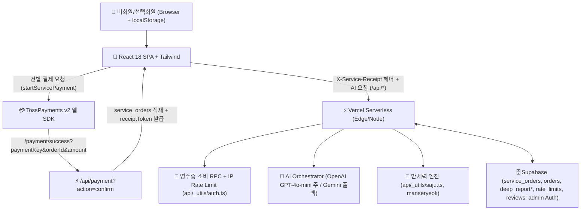

# 🤖 MBTIJU (엠비티아이주) - 에이전트 시스템 아키텍처 및 서비스 명세서 (`agent.md`)

> **문서 버전**: v2.0.0 (`2026-11-23` 비회원·건별 결제 전환)  
> **대상**: AI 코딩 에이전트 및 개발자  
> **언어**: 한국어 (Korean)  
> **목적**: MBTIJU 서비스의 아키텍처, 비회원 건별 결제 파이프라인, 데이터 모델, API 인터페이스 및 개발 규칙을 정의합니다.

---

## 1. 🌟 서비스 개요 및 비전

**MBTIJU(엠비티아이주)**는 만세력 기반의 **정통 사주명리학(四柱命理學)**과 **MBTI 성격 유형 분석**을 융합해 현대적인 운세·궁합·타로·심층 리포트를 제공하는 독립 웹 플랫폼(`https://www.mbtiju.com`)입니다.

### 핵심 제공 가치 (v2.1 운영 확정 모델)
1. **회원가입 ZERO 기본 · 선택적 소셜 로그인 유지**: 일반 운세·사주·자미두수·타로·궁합·AI 채팅을 로그인 없이 브라우저 인라인 입력(`GuestProfileCard`)만으로 즉시 이용. 추후 확장을 위해 카카오·구글 소셜 로그인(`/mypage`, `Navbar` 로그인 메뉴)은 선택 기능으로 유지하며, **이용후기 작성(`/reviews`)은 로그인 필수** 정책을 유지.
2. **투명한 건별 단품 과금 & 5단계 퍼널 UX (크레딧 선충전 폐지 + 서버 영수증 검증)**:
   - **무료 서비스 (`0원`)**: 오늘의 운세(`FORTUNE_TODAY`), 정통 만세력 4주 8자 원국표 및 끊겨있는 사주 프리뷰(`FreePreview.tsx`, `FreeSajuPreviewCard.tsx`)
   - **사주·자미두수 계열 (`990원`)**: MBTI × 사주 통합/재생성, 자미두수 12궁, 심층 궁합, 연애/부부/결혼/재회/짝사랑 사주, 재물/창업/취직/이직 사주
   - **운세·타로·테마 계열 (`490원`)**: 내일의 운세, 신비타로, 여행지 추천, KBO 팬궁합, AI 사주·타로 채팅(5회 이용권)
   - **표준 전환 퍼널**: `무료분석 유도 -> 1. 회원정보 기입 유도(GuestProfileCard) -> 2. 무료 결과(만세력 + 끊겨있는 분석 문장, FreeSajuPreviewCard) -> 3. 분석 더보기(결제창 이동) -> 4. 전체 분석 -> 5. 하단 3년 심층 리포트 받기 / 카카오톡 1:1 상담하기(FunnelBottomCta) 노출`
3. **고부가가치 3년 심층 사주 리포트 (`/premium`, `29,000원`)**:
   - 정가 49,000원 → 판매가 29,000원. 비회원 신청·결제 후 결정론적 만세력 계산 + AI 해석 + 관리자 수기 점검을 거쳐 A4 20장 내외 PDF/DOCX로 제공.
4. **카카오톡 채널 1:1 상담 일원화 (`/chat`, `/room`, `9,900원` / `19,900원`)**:
   - 웹 내 1:1 상담 티켓 결제 대신 `ConsultationPage`(`/chat`, `/room`)를 공식 카카오톡 채널 1:1 상담(`KakaoConsultCard`)으로 일원화. (1문항 9,900원 / 3문항 19,900원, 비회원 가능, 입금 확인 후 평일 기준 24시간 이내 답변)
5. **굿즈 상점 및 장바구니 (`/shop`, `/shop/cart` 준비 중 유지)**:
   - 상단 네비게이션 장바구니 아이콘 및 상점 라우트 클릭 진입을 허용하되, 전 품목/장바구니는 `"운세 상점은 현재 준비 중입니다"` 안내 후 홈으로 이동(실결제 미오픈).

---

## 2. 🏛️ 전체 시스템 아키텍처



---

## 3. 📂 디렉터리 구조 및 주요 파일 명세

```text
MBTI-Saju/
├── api/                             # [백엔드] Vercel Serverless Functions (Edge/Node)
│   ├── _utils/
│   │   ├── ai-provider.ts           # OpenAI GPT-4o-mini(주) / Google Gemini(폴백) 팩토리
│   │   ├── auth.ts                  # SERVICE_COSTS, X-Service-Receipt 소비/복구 RPC 검증, Rate Limit / 점검 모드
│   │   ├── rate-limit.ts            # Edge/Node IP 기반 Rate Limit 및 점검 모드 503 가드
│   │   ├── cors.ts                  # 허용 오리진 CORS + x-service-receipt 헤더 허용 (`*` 폴백 제거)
│   │   ├── prompts.ts               # 사주/MBTI 프롬프트
│   │   ├── saju.ts                  # 만세력 및 오행/십신 연산 엔진
│   │   └── report-*.ts              # 3년 심층 리포트 결정론적 계산 및 검증 엔진
│   ├── analysis-main.ts             # MBTI × 사주 통합 분석 API (requirePaymentReceipt + Admin 우회)
│   ├── analysis-special.ts          # 오늘/내일 운세, 자미두수, 여행, KBO API (requirePaymentReceipt)
│   ├── compatibility.ts             # MBTI × 사주 심층 궁합 API (requirePaymentReceipt)
│   ├── daily_relationship.ts        # 관계 조언 API (requirePaymentReceipt)
│   ├── gold.ts                      # 재물/창업/취직/이직 사주 API (requirePaymentReceipt)
│   ├── love-saju.ts                 # 연인/부부/결혼/재회/짝사랑 사주 API (requirePaymentReceipt)
│   ├── tarot.ts                     # 신비타로 3카드 리딩 API (requirePaymentReceipt)
│   ├── chat.ts                      # AI 사주/타로 채팅 API (AI_CHAT_5 영수증 차감 지원)
│   ├── payment.ts                   # TossPayments 승인(사전 금액 검증 + 보상 취소 + service_orders)/취소/조회(admin Auth)
│   ├── report-preview.ts            # /premium 무료 3년 점수표 미리보기
│   ├── generate-and-save-report.ts  # 심층 리포트 생성/저장
│   └── generate-deep-report.ts / generate-consultation-draft.ts # 관리자 전용 생성 API (allowAnonymous: false)
│
├── src/
│   ├── components/
│   │   ├── GuestProfileCard.tsx     # 공용 비회원 입력 카드 + 약관/청약철회 제한 사전 고지
│   │   ├── MbtiSajuModal.tsx        # MBTI × 사주 분석 모달 (990원)
│   │   ├── CompatibilityModal.tsx   # 심층 궁합 모달 (990원)
│   │   ├── DeepReportModal.tsx      # 3년 심층 리포트 신청·결제 모달 (29,000원)
│   │   ├── FeatureGrids.tsx         # [사주 990원] / [운세 · 타로 490원~] 카드 그리드
│   │   ├── Navbar.tsx / BottomNav.tsx / Footer.tsx / HeroSection.tsx
│   │   └── admin/, pdf/, saju/, tarot/
│   ├── config/
│   │   ├── creditConfig.ts          # SERVICE_COSTS(490/990원), SERVICE_NAMES, getServicePrice
│   │   ├── deepReportConfig.ts      # DEEP_REPORT_SALE_PRICE (29,000원)
│   │   ├── kakaoConsult.ts          # 카톡 채널 URL 및 9,900/19,900원 상수
│   │   └── schemas.ts               # Zod 응답 스키마
│   ├── hooks/
│   │   ├── useGuestProfile.ts       # localStorage(mbtiju_guest_profile) 비회원 프로필 동기화
│   │   ├── useAuth.ts / useCredits.ts / useModalStore.ts / useShop* / useSubscription.ts
│   ├── pages/
│   │   ├── MyLuckPage.tsx           # 운세 허브 (오늘/내일 490원, 타로 490원, 여행 490원, 자미두수 990원, KBO 490원)
│   │   ├── RelationshipPage.tsx     # 연애/부부/결혼/재회/짝사랑 사주 (990원)
│   │   ├── GoldPage.tsx             # 재물/창업/취직/이직 사주 (990원)
│   │   ├── ChatPage.tsx             # AI 타로/사주 실시간 채팅 (/tarot, /saju, 5회권 490원)
│   │   ├── PaymentSuccess.tsx       # Toss 승인 후 receiptToken 포함 SVC_* 티켓 승격 · orderId 복사 · 복귀
│   │   ├── ConsultationPage.tsx     # /chat, /room 카카오톡 채널 1:1 상담 일원화 안내
│   │   ├── ReviewCollectionPage.tsx # /reviews 이용후기 (작성은 로그인 필수 유지)
│   │   ├── ShopPage.tsx / CartPage.tsx # /shop, /shop/cart 클릭 진입 가능 ("준비 중" 안내 유지)
│   │   ├── PricingPage.tsx          # 건별 요금 안내 및 환불 규정 (/pricing, /store)
│   │   ├── TermsPage.tsx / PrivacyPage.tsx / SupportPage.tsx # 약관·개인정보·비회원 고객센터
│   │   └── admin/, DeepReportLandingPage.tsx, MyPage.tsx(선택 로그인 · 저장 리포트 · 잔여 레거시 크레딧 안내)
│   ├── payment/                     # TossPayments v2 SDK 래퍼 (`requestPayment`)
│   └── utils/
│       ├── servicePayCheckout.ts    # startServicePayment, buildServiceRequestHeaders, promotePendingOrderToTicket, consumePaidServiceTicket
│       ├── chatService.ts           # AI 채팅 클라이언트 (guest_ 세션 분기 포함)
│       └── sajuUtils.ts, pdfGenerator.ts, docxGenerator.ts, exportUtils.ts
└── supabase/migrations/             # PostgreSQL 스키마 및 RLS
```

---

## 4. 🗄️ 데이터베이스 및 클라이언트 저장 구조

### 서버 DB 주요 테이블 (Supabase PostgreSQL)
| 테이블 명 | 설명 |
|---|---|
| `deep_report_requests` / `deep_reports` | 3년 심층 리포트 비회원/회원 주문 및 생성 데이터·PDF |
| `kakao_consultations` / `consultations` | 카카오톡 및 1:1 전문가 상담 접수/답변 |
| `orders` / `products` | 실물 상품(`/shop`) 주문 및 재고 |
| `rate_limits` | Edge/Node 공용 IP·사용자 요청 빈도 제어 |
| `support_inquiries` / `reviews` / `profiles` / `credit_purchases` | 기존 회원 CS·리뷰·관리자 권한 및 레거시 유료 크레딧 조회 |

### 클라이언트 `localStorage` 키 (비회원 즉시 이용)
- `mbtiju_guest_profile`: 이름, 성별, 생년월일, 태어난 시간, MBTI
- `mbtiju_pending_service_order`: Toss 결제창 이동 직전 주문/입력 페이로드
- `mbtiju_paid_service_tickets`: `/payment/success` 승인 후 원래 화면 복귀 시 1회 자동 소비되는 티켓
- `mbtiju_guest_mbti_saju_result`: `MBTI × 사주` 로컬 결과 캐시
- `mbtiju_guest_chat_{service}` / `mbtiju_guest_chat_quota_{service}`: AI 채팅 이력 및 490원 5회권 잔여 횟수

---

## 5. 🔄 핵심 비즈니스 파이프라인

### 1) 비회원 건별 결제 & 즉시 분석 파이프라인
```text
[1] 서비스 화면에서 GuestProfileCard + 서비스별 입력값 작성 (localStorage 자동 저장)
     ↓
[2] 결제 버튼 클릭 (490원 또는 990원) → startServicePayment()
    - orderId = "SVC_{serviceType}_{timestamp}_{rand}" 생성
    - mbtiju_pending_service_order 저장 후 TossPayments v2 결제창 호출
     ↓
[3] 결제 완료 → /payment/success
    - POST /api/payment?action=confirm 에서 Toss 승인 + SERVICE_COSTS[serviceType] 금액 검증
    - promotePendingOrderToTicket(orderId) 후 returnPath로 자동 리다이렉트
     ↓
[4] 원래 서비스 화면 마운트 → consumePaidServiceTicket()
    - 1회 티켓 소비 후 /api/* AI 스트리밍 즉시 호출 → 결과 렌더링
```

### 2) 단건 요금표 (`src/config/creditConfig.ts` & `api/_utils/auth.ts`)
- **990원 (사주·자미두수)**: `MBTI_SAJU`, `REGENERATE_MBTI_SAJU`, `JAMIDUSU`, `COMPATIBILITY`, `GOLD_WEALTH`, `GOLD_BUSINESS`, `GOLD_JOB`, `GOLD_JOBCHANGE`, `LOVE_COUPLE`, `LOVE_MARRIED`, `LOVE_MARRIAGE`, `LOVE_REUNION`, `LOVE_CRUSH`
- **490원 (운세·타로·테마·채팅)**: `FORTUNE_TODAY`, `FORTUNE_TOMORROW`, `TAROT`, `TRIP`, `COMPATIBILITY_TRIP`, `KBO`, `AI_CHAT_5`(5회권), `RELATIONSHIP_ADD`
- **프리미엄/별도**: 3년 심층 사주 리포트 `29,000원` (`deepReportConfig.ts`), 카카오톡 1:1 상담 `9,900원 / 19,900원` (`kakaoConsult.ts`)

---

## 6. ⚠️ AI 코딩 에이전트 개발 수칙 (Strict Rules)

1. **비밀 키 서버 격리**: `GEMINI_API_KEY`, `OPENAI_API_KEY`, `SUPABASE_SERVICE_ROLE_KEY`, `TOSS_SECRET_KEY`는 `api/` 내부에서만 사용.
2. **비회원 건별 결제 및 가격 단일 소스**:
   - 일반 유료 기능은 로그인 게이트나 크레딧 차감을 복원하지 말고 `startServicePayment()` / `consumePaidServiceTicket()` 패턴을 사용한다.
   - 가격은 반드시 `src/config/creditConfig.ts` ↔ `api/_utils/auth.ts` (`SERVICE_COSTS`), `src/config/deepReportConfig.ts`를 일치시킨다.
3. **엄격한 스키마 및 결정론 연산**: 사주/대운 계산은 `manseryeok` 기반 코드(`api/_utils/saju.ts`, `src/utils/sajuUtils.ts`)로 확정하고, AI 응답은 Zod 스키마(`src/config/schemas.ts`)로 검증한다.
4. **AI 프로바이더 우선순위 유지**: `api/_utils/ai-provider.ts`의 OpenAI(주) → Google Gemini(폴백) 순서를 임의로 변경하지 않는다.
5. **법적·마케팅 문구 정합성**: `"1,000만 건"`, `"크레딧 충전"`, `"가입 필수"` 표현을 UI/문서에 넣지 않는다.
